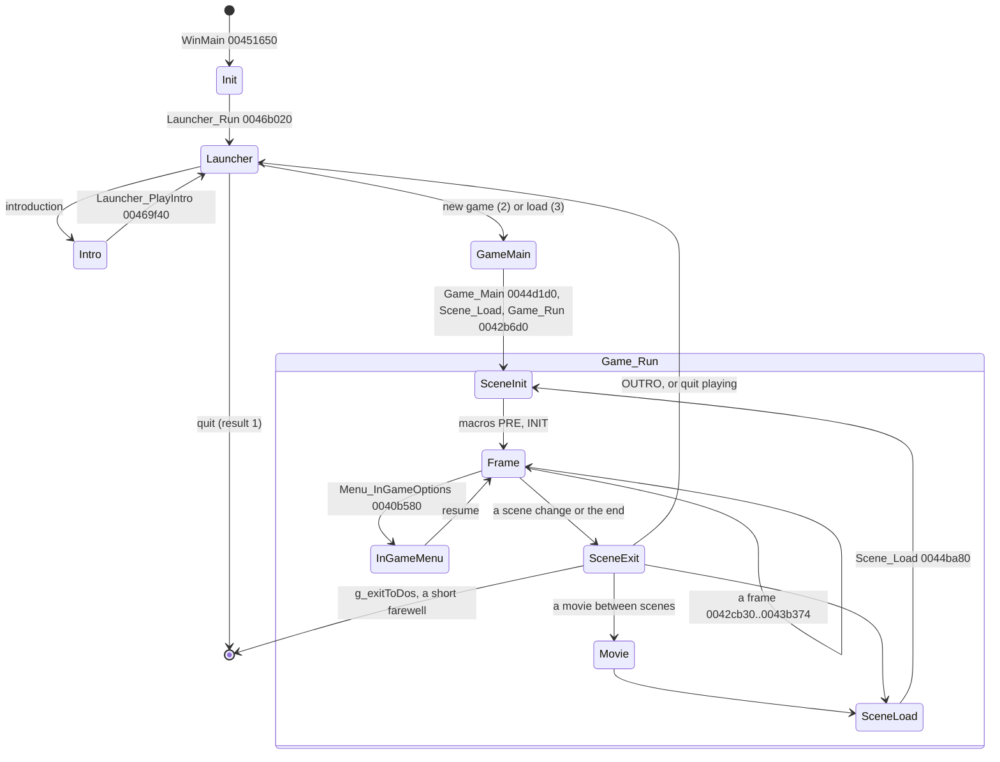

# Architecture of the original engine

How the original Windows program is put together: startup, loops, the state machine, timing, DirectX, and memory. File formats are not described here. Each loader is named, and the format notes are in [../formats](../formats/).

Addresses are procedure addresses in the executable. Almost every call in the game goes through a 5-byte `jmp` thunk in `0x401000`–`0x401bff`. Names in this note are labels for those procedures.

The listing of `Game_Run` (`0042b6d0`, about 67 KB) was incomplete for a long time. The description below was built from the disassembly and gives instruction addresses. Read it together with [game_loop.md](game_loop.md).

## Traces of the DOS port

The code still carries the DOS version, and that explains several odd constructions:

- `Game_Main(int argc, char **argv)` (`0044d1d0`) has a `main` signature. It checks `argv[3]` for a last-scene token and `atoi(argv[4])`. `WinMain` calls it with `(1, NULL)`, so that path is dead.
- Debug prints go through `printf` (`00487230`) and `_getch` (`0049f260`, `ReadConsoleInputA`).
- Strings still mention a missing VBE 2.0 driver (`0046a430`).
- There is no classic `GetMessage` loop in `WinMain`. Each long-running loop pumps messages itself, the way a DOS build would poll the keyboard.

## Program start

```
entry (00489aa0) CRT: GetVersion, heap, GetCommandLineA, _initterm
 └ WinMain (00451650)
  ├ Sys_InitConfigAndCd (00469b70) registry, then a search for the movies folder
  ├ RegisterClassA / CreateWindowExA class and title "Jack Orlando", WndProc = 00450d10
  ├ Sys_InstallCrashHandler (0047f930) SetUnhandledExceptionFilter(0047f960)
  ├ Timer_Init (0045ce10)
  ├ Input_Init (0045c230) DirectInput8
  ├ Input_InitKeyboard (0045ba70)
  ├ Sound_Init (00474500, 44100 Hz) DirectSound8; a failure means the game runs silent
  ├ ShowWindow, UpdateWindow
  ├ Video_Init (00452900) DirectDrawEnumerateExA
  ├ Video_SetMode (00453040) 640×480×16, work buffer 1024×480
  ├ 0045d300 clears 10 GUI windows (0x14e0 bytes from 0x9d3638)
  ├ File_Exists of the intro movie -> g_introOnHdd (0x8f689c)
  └ loop: do { r = Launcher_Run(); if (r != 1) Game_Main(1, 0); } while (r != 1)
  then cleanup: ReleaseMutex, Video_Shutdown, Input_Shutdown, Timer_StopAll
```

- A static initializer `00402720` calls `Sys_CreateMutex` (`00402740`) for a mutex named `"Jack Orlando"`. `WinMain` starts with `GetLastError() == ERROR_ALREADY_EXISTS (0xb7)` and exits at once. A second instance does not start.
- `WinMain` receives `hPrevInstance` and registers the class only when it is 0.
- The window style is `0x00ce0000`, the starting size is 300×300, and `WM_GETMINMAXINFO` forces a client area of 640×480.
- `Video_SetMode(2, …)` is full screen. `Video_SetMode(1, …)` is a window, chosen from the registry value `InWindow` (`0x9fa97e`).

### Configuration (`00469b70`)

The key is `HKLM\Software\TopWare Poland\Jack Orlando`.

| Value | Read | Variable | Meaning |
|---|---|---|---|
| `Directory` (string) | `Reg_GetInstallDir` `00469900` | `0x9faa80`, copied to `g_installDir` `0x9fa980` (with a trailing separator) | the install directory. Empty means the game does not start |
| `Config` (binary, 0x26 bytes) | `Reg_LoadConfig` `00469a30` | the block `g_config` `0x9fa958` | settings. Missing means the defaults, then `Reg_SaveConfig` `004699a0` |
| `InWindow` (dword) | `00469a30` | `0x9fa97e` | non-zero means windowed |
| `EasyVer` (dword) | `00469a30` | `g_easyVersion` `0x5348ac` | the easy version. `GUN` is set once (at start or a new game), and `LIGHTVER` is set at the start of every scene (`0042bb69`, [easy.md](easy.md)) |

Default fields of `g_config` (`00469b70`): `+0x02`, `+0x04`, `+0x06`, `+0x08` are 1, `+0x0a` is 0x23, `+0x0c` is 0x20, `+0x0e` is 0x40, and `+0x12`, `+0x14`, `+0x16` are 1. `+0x0a` is the music volume. `Game_Tick14ms` (`00426c10`) multiplies it by a coefficient while fading. `+0x12` (`0x9fa96a`) means "play the intro at startup" and is cleared after the first play in `Launcher_Run`. The other fields are a hypothesis: speech and effect volumes, and the options from the game-options menu. `WinMain` overwrites `g_config+0` (`0x9fa958`) with a "no sound" flag when `Sound_Init` fails.

`Sys_FindCdDrive` (`00469810`) checks the current drive, then the other drives, for the intro movie (`Sys_IsGameCd` `004697a0`). The letter goes to `g_cdRoot` (`0x9fa970`). A digital install keeps the movies next to the game, so the current drive passes. Message text depends on `g_language` (`0x503b65`): `'P'`, `'D'`, otherwise English. The Polish build stores `'P'` in `.data`.

Writing `Config` uses `KEY_ALL_ACCESS` on that key, which fails silently on a normal account. The engine keeps settings in `localStorage` under `jack-orlando.config`.

## The message pump and pause

The game has no single main loop in `WinMain`. Every long loop (the launcher, the game, movies, dialog windows) calls `Sys_PumpMessages` (`00451490`) each iteration, passed in as a callback (`Launcher_Run(…, pump)`, `Timer_Init(pump)`, `Input_Init(…, pump)`). The callback returns `g_quit` (`0x8f6880`). The caller leaves the loop when that is not 0.

`Sys_PumpMessages`:

1. Guards against recursion (`0x8f6884`).
2. `PeekMessage` / `GetMessage` / `DispatchMessage` for every waiting message. `WM_QUIT` sets `g_quit` to 1 and calls `Sys_FatalExit` with a short farewell.
3. When the window is active (`g_appActive` `0x8f6888`), `Video_PresentIfDue()`. A result of 0 (a frame was shown, or it is not time yet) ends the pump. A non-zero result (a present failed) does `Sleep(10)` and repeats.
4. When the window is **inactive**, it spins in `Sleep(10)` (in windowed mode it still presents frames) until the window is active again. That is the whole pause: the game code stands inside the pump call.
5. After activity returns it resumes the timers, input, and sound (`Timer_SetPaused(1)`, `Input_SetAcquired(1)`, `Sound_SetPaused(1)`).

The engine's pause policy is in [pause.md](pause.md). Blur pauses by default. A hidden or throttled page always pauses. The game advances with `game.advance(info.elapsedMs)`.

`WndProc` (`00450d10`):

| Message | What it does |
|---|---|
| `WM_DESTROY` | `PostQuitMessage(0)` |
| `WM_SIZE` | minimized sets `g_appActive` to 0 |
| `WM_ACTIVATE` | deactivation pauses timers, input, and sound and sets `g_appActive` to 0. Activation sets `g_appActive` to 1 and `g_needResume` (`0x8f688c`) to 1 |
| `WM_PAINT`, `WM_ERASEBKGND` | `Video_PresentIfDue()` |
| `WM_SETCURSOR` | hides the system cursor while the game draws its own |
| `WM_GETMINMAXINFO` | client area 640×480 |
| `WM_SYSCOMMAND` | in full screen, blocks move, size, maximize, and the screensaver |
| `WM_SYSKEYDOWN` F10 | swallowed |
| `WM_MOUSEMOVE` | `g_mouseX = LOWORD + g_scrollX`, `g_mouseY = HIWORD + g_scrollY` (`0x9d2804` / `0x9d2800`) |
| `WM_[LRM]BUTTON{DOWN,UP}` | the button mask `0x9d2828` (bit 0 left, bit 1 right, bit 2 middle) and the flags `0x9d2820` / `24` / `1c` |

**The mouse comes through window messages, not DirectInput.** DirectInput handles the keyboard and joysticks. Joystick handling is abandoned.

## Timing

### The timer service

`Timer_Init(pump)` (`0045ce10`):

- `Timer_InitHiRes` (`0045c9f0`): `QueryPerformanceFrequency`. When that is missing, `timeBeginPeriod(1)` and `timeGetTime`.
- `Timer_CalibrateTsc` (`0045c890`): measures the `rdtsc` increase over a quarter of a second, times 4, and stores the CPU frequency in `g_tscPerSecond` (`0x9d31f0`, 64-bit).
- `timeSetEvent(5 ms, …, TIME_PERIODIC)` with `dwUser = 5` calls `Timer_TickCallback` (`0045cc60`), which increments the global tick counter `g_ticks5ms` (`0x9d3208`) every 5 ms.

Timer slots 0–5 (callbacks at `0x9d3180`, handles at `0x9d3198`, `0x12345678` means free). `Timer_Start(slot, ms, fn, mode)` (`0045d070`): mode 1 is a multimedia timer (`timeSetEvent`, callback `Timer_MmCallback` `0045cc90`, guarded against re-entry). Mode 0 is a thread (`Timer_ThreadProc` `0045ccf0`: calls `fn`, then `Sleep(ms − the time already spent)`). When `g_timersPaused` (`0x9d3210`) is not 0, no callback runs.

| Slot | Period | Mode | Function | Who starts it |
|---|---|---|---|---|
| 0 | 50 ms | thread | `Sound_MixerTick` `00474470`, refills streams on channels 1–6 | `Sound_Init` |
| 1 | 17 ms | mm-timer | `Launcher_TimerTick` `0046c090` | `Launcher_Run` |
| 1 | 5 ms | mm-timer | `Game_TimerTick` `00426990` | `Game_Main` (`0044d1d0`) |
| 2 | 14 ms | mm-timer | `Game_Tick14ms` `00426c10`: music volume on channel 5, scrolling (4 px a tick, range 0..376), the `CDxx` animation | `Game_Main` |
| 4 | 40 ms | thread | `Input_Poll` `0045bfc0`, the keyboard buffer and joysticks | `Input_Init` |
| 5 | 5 ms | mm-timer | `Timer_TickCallback`, `g_ticks5ms++` | `Timer_Init` |

`Game_TimerTick` (`00426990`): every third call (15 ms) runs a logic tick. It decrements delay counters (`0x54d6e8[]`, `0x5640d8[17]`, `0x8713f4`, `0x51fa5c`, and others) and increments the game variable pointed at by `0x55b278` every 64 ticks. Some ticks run twice (a `while` loop, counter `0x69c7b8 < 0xb`; the extra run also increments the counter). The first doubled tick is the 11th, then every 10th. That is 11 logic runs in 150 ms (about 73.3 Hz). The assumed start value of `0x69c7b8` is 0. The engine: `packages/engine/src/core/`.

### A game frame

In `Game_Run` (`0042b6d0`):

- `0042cb30` is the start of a frame. `Timer_MarkFrameStart` (`0045cb60`) stores `g_ticks5ms` in `g_frameStartTick` (`0x9d3200`).
- `0043b33b` is the end. `g_frameCounter++` (`0x8f686c`). If `g_quit`, leave. `Sys_PumpMessages()`. `Timer_WaitSinceFrameStart(g_frameMinMs)` (`0045cb80`, `g_frameMinMs` `0x504786` is **5**, a constant in `.data` that the code never changes). It waits until **more than** `5/5 = 1` tick has passed since the start of the frame, which is 5–10 ms, while pumping messages.

The cap is therefore about 100–200 logic frames a second. The animation tempo comes from the counters that `Game_TimerTick` decrements. `Timer_Sleep(ms)` (`0045caf0`) is a busy wait of N times 5 ms with pumping, used in animations, transitions, and menus.

### Presenting the picture

Drawing (blits into the work buffer) and presenting to the screen are separate. `Video_PresentIfDue` (`00450bc0`), called **from the message pump**, presents a frame only when `g_tscPerRefresh` (`0x723e28`) `rdtsc` cycles have passed since the last present. `Video_CalibrateRefresh` (`00450a30`) measures the monitor with `IDirectDraw7::GetVerticalBlankStatus` (3 agreeing measurements, at most 10 tries), rounds down to a multiple of 5 Hz (the default, and anything above 400 Hz, is 120), and stores `g_refreshHz` (`0x7a9a10`) and `g_tscPerRefresh = g_tscPerSecond / g_refreshHz`. `Video_OnSurfacesRestored` (`00451610`) calls it.

`Video_Present` (`00452310`):

- Windowed (`g_videoFlags & 1`): `Blt` from the work buffer (the rectangle `g_scrollX, g_scrollY, +640, +480`) to the primary, into the window (`ClientToScreen`).
- Full screen: `Blt` to the back buffer, or `BltFast` plus `Flip` when `g_videoFlags & 4`.
- `DDERR_SURFACELOST` restores the surfaces and calls `Video_OnSurfacesRestored`.
- After a successful present it calls the hook `g_onPresent` (`0x9bb358`): `Sys_NullCallback` (`00451c30`) outside the game, `Cursor_DrawOnPresent` (`00426370`) in the game, `Launcher_OnPresent` (`0046bea0`) in the launcher. The hook draws the mouse cursor (animated, the frame chosen from mouse motion, nine pictures `WSK00`–`08.BM` at `0x555550`). That last point is a hypothesis from the contents of the hook.

The public presenter is `packages/engine/src/render/present.ts` and `packages/engine/src/core/display.ts`. `PlayGame` has no DOM. See [play.md](play.md).

## DirectX

### DirectDraw (`Video_*`, `00452900`–`00454730`)

| Step | Details |
|---|---|
| `Video_Init(hwnd, onRestore)` `00452900` | `DirectDrawEnumerateExA(Video_EnumDeviceCallback 00452980, 0, 7)`. The device table is `0x9bb590` (0x278c bytes each), the count is `0x9c5444` |
| `Video_SetMode(flags, 640, 480, 16, 1024, 480, device)` `00453040` | `DirectDrawCreateEx` into `g_ddraw` (`0x9c547c`, `IDirectDraw7`) |
| window (`flags & 1`) | `SetCooperativeLevel(DDSCL_NORMAL)`, a primary surface, a clipper on the window |
| full screen (`flags & 2`) | `SetCooperativeLevel(FULLSCREEN\|EXCLUSIVE\|ALLOWREBOOT)`, `SetDisplayMode(640,480,16)`, a primary with one back buffer |
| work buffer | an offscreen **1024×480** in video memory, or in system memory on failure, at `0x9c5470` |
| surfaces | primary `0x9c546c`, work `0x9c5470`, back `0x9c5474`, `0x9c5478` (a hypothesis: a second offscreen), clipper `0x9c5488` |
| `Video_Shutdown` `00454590` | `RestoreDisplayMode` in full screen, then Release of everything |
| `Video_DDrawErrorBox` `00454730` | turns `DDERR_*` codes into text and shows a message box |

The work buffer is 1024 wide because scenes scroll. The background is wider than the screen, and the present copies a window from `g_scrollX` (`0x9c5494`). Drawing in the buffer is **16 bpp**. Blits copy `uint16` (`Blit_Copy16` `0046dd50`). Pictures in memory have a header `uint16 w, h` plus the pixels. See [bm.md](../formats/bm.md) and [render.md](render.md).

A digital install may ship a DirectDraw wrapper. The game still speaks the DirectDraw interface.

### DirectInput8 (`Input_*`)

- `Input_Init(hwnd, hinst, pump)` `0045c230`: `DirectInput8Create` into `0x9d2d5c`, `EnumDevices(DI8DEVCLASS_GAMECTRL, Input_EnumJoystickCallback 0045c0d0, …, DIEDFL_ATTACHEDONLY)` (up to 4 controllers, `0x9d2d68`…`74`), and `Timer_Start(4, 40 ms, Input_Poll, thread)`.
- `Input_InitKeyboard` `0045ba70`: `CreateDevice(GUID_SysKeyboard)` into `0x9d2d64`, `c_dfDIKeyboard`, `SetCooperativeLevel(NONEXCLUSIVE|FOREGROUND)`, `DIPROP_BUFFERSIZE = 16`.
- Key state: `g_keys[256]` (`0x9d2c58`, the index is a `DIK_*` code, `0x80` means down, 0 means up) and a separate "once" table (0/2/1) for `Input_KeyPressedOnce`. Events are applied by `0045b320`. `Input_IsKeyDown(dik)` `0045a770` (pseudo-codes `0xfa` / `0xfb` / `0xfc` are **Alt / Shift / Ctrl**, left or right), `Input_KeyPressedOnce(dik)` `0045a880`, `Input_GetLastKey` `0045a860` (`0x9d2d78`), `Input_WaitKey` `0045a810`.
- `Input_SetAcquired(0/1)` `0045c540` unacquires and acquires on focus loss and return.

Short keypresses can be lost. See [keys.md](keys.md).

### DirectSound8 (`Sound_*`)

- `Sound_Init(hwnd, pump, 44100)` `00474500`: `DirectSoundCreate8`, `SetCooperativeLevel(3 = DSSCL_EXCLUSIVE)`, a primary buffer looping, the format from `GetCaps` (16-bit when `DSCAPS_PRIMARY16BIT`, stereo when `DSCAPS_PRIMARYSTEREO`), **7 channels** (structures of 0x9c bytes from `0xa00668`), `Timer_Start(0, 50 ms, Sound_MixerTick, thread)`.
- `Sound_MixerTick` `00474470`: for channels 1–6 with status `& 0x40` (a stream) it calls the refill `00471fe0`. A hypothesis: that is the PMS and ADPCM decode. See [sound.md](../formats/sound.md) and [audio.md](audio.md).
- `Sound_SetChannelVolume(ch, vol)` `004748a0`. Channel 5 is the music (the fade is in `00426c10`).
- `Sound_SetPaused(0/1)` `004719a0`, `Sound_Shutdown` `00471ab0`.

## The state machine



### The launcher (`Launcher_Run`, `0046b020`)

This is the title screen, not a music initializer. It loads `MENU.PAK` (`Menu_OpenPak` `0046a900`), allocates buffers (a background of `0x12c4b0` bytes and others), creates a GUI window (`Gui_CreateWindow` `0045e2f0`) with the buttons Intro, Start, Load, and Quit (captions from `Lang_InitLauncherStrings` `0046a430`), and plays `TR02-22.PMS`. On the first run (`g_config+0x12`) it plays the intro at once. The result:

| Button | Result | Next |
|---|---|---|
| Introduction | — | `Launcher_PlayIntro` (`00469f40`: the studio logos, then the intro movie), back to the menu |
| New game | 2 | `Game_Main` |
| Load | 3 | `Game_Main`. `0x6d504c = 1` is a hypothesis that the load window opens after startup |
| Quit | 1 | the close animation `0046c610`, then `WinMain` returns |

The result is stored in `g_launcherResult` (`0x6da5a8`). The engine screen is [mainmenu.md](mainmenu.md). The logos and the first-launch wait are [launcher.md](launcher.md).

### `Game_Main` (`0044d1d0`)

It does three things, then hands control to `Game_Run`:

1. **Only on the first entry** (`g_firstRun` `0x5047d4` is 1 in `.data`, cleared before `Game_Run`): it allocates the global memory block (below) and loads Jack's animations.
2. It sets the starting scene to `SC001` and the file names `SC001.CCG`, `SC001.PHK` (`0x69c7c0`), `SC001.PH2` (`0x86fc18`), and `DATA\SC001.PH2` (`0x71a068`).
3. It opens the archives and loads the global resources (the table below), sets the UI texts from `g_language`, starts timers 1 and 2, reads `VARIABLE.ALL`, opens the scene archives, calls `Scene_Load("SC001.CCG")`, creates the frame and cursor sprites, and calls `Game_Run()`.

Archives (`Pak_Open`):

| Variable | Archive | Loaded by |
|---|---|---|
| `g_pakResource` `0x86f980` | `RESOURCE.PAK` | `Res_Load` / `Res_LoadAlloc` |
| `g_pakGlobal` `0x7ca0d0` | `GLOBAL.PAK` | a hypothesis: scene pictures and sounds through `Pak_LoadFile` |
| `g_pakAction` `0x89c6f0` | `ACTION\SCxxx.PHK` (from the movies location or the install, according to `g_introOnHdd`) | the scene description (`Scene_Load`) |
| `g_pakSceneGfx` `0x6c2750` | `DATA\SCxxx.PH2` when it exists (the flag `0x7a6e58`) | the scene pictures |

`.PHK` and `.PH2` are **archives in the PAK format** (the header `"PAK\0"`). See [pak.md](../formats/pak.md). `SC001.PHK` holds `SC001.CCG`, `GLOBAL.CCG`, `SC001.ACI`, `.DCN`, `.DCG`, `.ACE`, `.ICS`, `.FCM`, and the rest. `SC001.PH2` holds the `.PBM` pictures.

### `Game_Run` (`0042b6d0`)

Three nested loops. The frame itself is [game_loop.md](game_loop.md).

```
0042b6d0 prologue: LANVER / ISSOUND / GUN / LIGHTVER from the version (Var_Set)
0042bb86 scene loop
  reset of about 150 scene-state variables, a copy SAVEGAME\tempjs (the state
  for the autosave), UI sprites, Script_StartMacro("PRE"), 0041a330,
  exceptions for SC000D, SC008B, SC000C, SC002, SC005B,
  the variable LAST, Script_StartMacro("INIT")
0042cb30 frame loop
  Timer_MarkFrameStart; the mouse into world coordinates (+scroll)
  the cursor (0042b0f0), the notice bar (0042a0d0 / 0042a1f0)
  Jack's direction g_jackDir 0x8f6916
  keys: save and load (0042b660), the menu (0040b580)
  scene exits, timed macros, persons, movement, shadows, sprites
004363ec scene-object animations
004381b5 return from the options menu
004381ba modal screens: the map, the coat, a wait for F1
0043b33b g_frameCounter++, g_quit, Sys_PumpMessages, Timer_WaitSinceFrameStart
0043b374 while (1). Leave by a jump (a scene change, or the end of the game)
0043b37a leaving the scene: sprites, free the scene, an optional movie
  (OUTRO.AVX sets g_gameFinished 0x5348c0), write .sav or .svl,
  Pak_Close, Pak_Open of the next archives, Scene_Load
0043bc58 repeat while g_sceneChange (0x7c7d1d) and not g_gameFinished
0043bc5e cleanup. g_gameFinished closes every archive. g_exitToDos (0x8f6874)
  calls Sys_FatalExit with a short farewell. Otherwise it waits for Esc
  to be released and returns to the launcher
```

### Modes inside a scene

There is no single "game state" variable. The scene state is a set of flags. The important ones:

| Variable | Meaning |
|---|---|
| `g_cursorMode` `0x8f68f6` | the cursor or verb mode, 0–5. 0–4 are the pointer, take, strike, examine, and the revolver. 5 is an item in the hand. `Cursor_ResetMode` `00419740` clears it. `0042b0f0` sets the hotspot from the mode. `0042ec75` sets 5. The mapping of 0–4 onto the captions is a hypothesis. See [cursor.md](cursor.md) |
| `g_jackDir` `0x8f6916` | Jack's direction 0–4 (front, profile, back, three-quarter). `004146e0`: LU/RU become 4, LD/RD become 3 |
| `0x563f20`, `0x8f68dc` | the notice bar, slid out by `0042a0d0` (up to 0x20 steps, then `0x8f68dc = 2`) and slid in by `0042a1f0` (`0x8f68dc = 0`). See [game_loop.md](game_loop.md) |
| `g_sceneChange` `0x7c7d1d` | a request to change the scene |
| `g_gameFinished` `0x5348c0` | the last movie was `OUTRO.AVX` (`0043b628`) |
| `g_exitToDos` `0x8f6874` | end the program after leaving the game. Read at `0043bd7c`. **No write exists in the code** |

Dialogs have no separate loop visible in `Game_Run`. Scene scripts drive them (`DIALOG`, `SETDIALOG`, `IFANSWER`, `TALKRANDOM`, `HIDETALK` in the macro compiler `00440cb0`). That is a hypothesis about the loop, and the commands themselves are in [dialog.md](dialog.md) and [scripts.md](scripts.md). Modal windows (options, save, load) are the GUI, `Gui_CreateWindow` (`0045e2f0`, 10 windows of 0x14e0 bytes from `0x9d3638`), each with its own pumping loop. See [gui.md](gui.md).

## Scene scripts

`Scene_Load(name)` (`0044ba80`) builds the file names and calls the loaders. The files come from the `.PHK` archive.

| Extension | Loader | Notes |
|---|---|---|
| `.CCG` | `004486d0` | sections for pictures, elements, the walk area, lights, perspective, and letter colors |
| `.DCN` | `00440520` | dialog text |
| `.FCC` | `00440010` | faces |
| `.PCS` | `0044a000` | persons |
| `.ACE` | `004475e0` | click areas |
| `.ACI` | `00448410` | object animations |
| `.SSD` | `0044ad00` | refers to `KROK1.SND` and `KROK2.SND` |
| `.ICS` | `0044af70` | insertions |
| `.FCM` | `0044b430` | filmed sequences |
| `.MCC` | `Script_CompileMacros` `00440cb0` | macros, about 150 text commands |

`Script_CompileMacros` (`00440cb0`) is called **only** from `Scene_Load`. It compiles the macro text to numeric codes and reports a missing `EndIf`. Execution: `Script_StartMacro(name)` (`004247c0`) then `Script_FindMacro` (`0040d8b0`, macros of 0x46 bytes from `0x54d870`, the count `0x55155c`) marks the macro active. `Script_AnyMacroActive` (`0040d850`) checks `0x7bf598[0x96]`. `0041a330` (31 KB) runs the compiled commands: a `switch` on codes `1..0xa3`, and an unrecognized command is reported. That is `Script_ExecStep` (`switch (code − 1)`). The catalog is [scripts.md](scripts.md).

Game variables: `Var_LoadAll` (`0044a600`) reads `VARIABLE.ALL` from `RESOURCE.PAK` into names of 0x1e bytes from `0x8a37a8` and `int16` values from `0x8a27d8`. The count is `g_varCount` (`0x8f68f0`). `Var_Get(name)` `00406630` and `Var_Set(name, v)` `004065b0` search the names linearly. The file format is [text.md](../formats/text.md).

## Loading resources

| Function | What it does |
|---|---|
| `Pak_LoadFile(pak, name, dst, max)` `00457f20` | `Pak_OpenFile` plus a read in 64 KB pieces into `dst`. `max = 0` means the whole file |
| `Pak_GetFileSize(pak, name)` `00457eb0` | the entry size, or −4 when it is missing |
| `Res_Load(name, dst)` `00408950` | `Pak_LoadFile(g_pakResource, name, dst, 0)`. Any file into a fixed buffer |
| `Res_LoadAlloc(name, &ptr)` `00416a10` | `new(size)` plus `Pak_LoadFile` from `RESOURCE.PAK` |
| `Res_MakeNumberedName(base, n, ext, digits)` `00409750` | a numbered name with a leading zero when `digits` is 2 and `n < 10` |

What `Game_Main` loads:

| Files | Function | Purpose |
|---|---|---|
| `CD00`…`CD38.BM` (every other frame), `WSK.BM`, the arrows, the bar, the frame, the bullet icons, the shadow, the window frame, the slider | `Res_Load` | fixed buffers in `.data` |
| `WSK00`–`08`, the hand, the lens, the mask, and the exit-cursor series | `Res_Load` plus `Res_MakeNumberedName` | cursor and UI animations. The names were checked in `RESOURCE.PAK` |
| face pictures, mouth and eye frames, walk and turn shadows | `Res_LoadAlloc` | faces and Jack's animations, only the first time |
| `IM240`…`IM312.PBM` | `Res_Load` | |
| `ELEM.LST` | `Res_Load` into `0x8a2bf0` | coat item names ([text.md](../formats/text.md)) |
| `CM220`…`CM316.BIN` | `Res_Load` | |
| `SFX.S16`, `TALK.S16` | `Res_LoadAlloc` | volume previews |
| `VARIABLE.ALL` | `Var_LoadAll` `0044a600` | game variables |
| `*.SFB`, the stand frames, `ROTP17.PBM` | `00416a90` and `00417e40` | Jack's animations, civilian and uniform (`JACKISWOJ`) |
| the two cursor icon sets | `Cursor_LoadSet1` `00408990` / `Cursor_LoadSet2` `00408a40`, from `GUN` | verb icons |
| `FIR00`–`31`, and the named series `haf` / `jack` / `stad` | names only, in tables | `FIR*.BM` live in `GLOBAL.PAK`. A hypothesis: loaded lazily |
| `SC001.CCG` and the scene files | `Scene_Load` | the starting scene |

`Game_Run` loads further: `MUSIC\*.PMS`, `MOVIES\*.AVX`, `MAP2.BM`, the two coat layouts `INV_[MC].BM` and their arrows and option buttons, `MONEY.BM`, and `OUTRO.BM`.

The public engine does not open these archives itself. The host passes bytes through `GameFiles` (`packages/engine/src/play/game.ts`). `packages/engine/src/play/files.ts` is `diskFiles()`, a directory opened for tests.

## The global memory block (0x45a954 bytes)

On the first entry `Game_Main` does `operator new(0x45a954)` into `g_bigBlock` (`0x5533f4`) and sets pointers at the subregions. The size of a region is the difference of the neighboring offsets.

| Offset | Size | Pointer | Use |
|---|---|---|---|
| `0x000000` | 1 000 000 | `g_bigBlock`, also `g_bgWork` `0xa00be0` | a copy of the scene background, restored under sprites (`Scene_RefreshBackground` `0040dff0`). A hypothesis from the use |
| `0x0f4240` | 1 230 000 | `g_guiHeap` `0x9e3354`. After a scene starts, `g_bgWork = g_bigBlock + 1e6` | GUI window memory (`Gui_CreateWindow` takes 500 000 bytes) and a background copy (`0046da60`). A shared region |
| `0x2206f0` | 300 000 | `0x8acb88` | the scaled person picture (`004146e0`, `004150f0`, `00415960`, `00427280`). A hypothesis |
| `0x269ad0` | 975 364 | `g_sceneBg` `0x54d86c` | the scene background (`uint16 w, h` plus 16 bpp pixels, copied into `g_bigBlock` as `w*h*2+4` bytes) |
| `0x357cd4` | 200 000 | `g_fileBuf` `0x8ab8c8` = `g_textBuf` `0x6e355c` | a scratch buffer: `VARIABLE.ALL`, scene files parsed by `Pak_ReadText`, save copies (`00407bb0`) |
| `0x388a14` | 560 000 | `0x7a8400` | a decompress or animation buffer in `00407750`. A hypothesis |
| `0x411594` | 228 144 | `0x8ab8c4` | the top bar (`BELKA.BM` times 3 widths, `00408af0`) |
| `0x4490c4` | 35 912 | `0x8f5dc8` | buffers in `00413970` / `00413e20`. A hypothesis: a person shadow |
| `0x451d0c` | 35 912 | `0x8ad360` | the same |

The block is never freed and never reallocated. A second entry into `Game_Main` skips the allocation.

## Sprites

`Game_*` does not draw straight to the screen. It creates sprites on a list sorted by `z`. The list starts at `0xb2add0`, 0x28 bytes an element, sorted ascending by `z` (`+0x0a`). The count is `0xb2bd7c`. The id counter is `0xb2bd80`. `Sprite_Add` returns an id. The clip defaults to `0, 0, 1016, 480`. `scale` is a `float`, almost always `16.0`. `Sprite_Set` changes the position or the picture. `Sprite_Remove` removes it and redraws the rectangle (`Render_RedrawRect` `00475ee0`, limited to 1016×480). Pictures are `uint16 w, h` plus 16 bpp pixels. The details, the sprite kinds, the scale, and the softening are in [render.md](render.md).

## The debug flag `0x8f6875`

`g_debug` is a byte.

- The only write in the whole executable is `0044d299` (`Game_Main`), which sets `g_debug` to 0. A search of every function and of the raw bytes finds that address only as a read operand. The initial value is 0 (the `.bss` section).
- 58 reads in `Game_Main`, `Scene_Load` (`0044ba80`), `004486d0`, `00440cb0`, and `0040dff0`: progress text while loading, a wait for a key after each step (`_getch`, `Input_WaitKey`), and, in the macro compiler, a write to a debug log.

The neighboring byte `g_exitToDos` (`0x8f6874`) is also only read.

In the Windows build both flags are dead. A hypothesis: the DOS version set them from the command line (compare `argv` in `Game_Main`). Turning them on would need a memory patch.

## Leaving the program

- The normal path: `WinMain` after `Launcher_Run()` returns 1. `ReleaseMutex`, `Video_Shutdown` (`00454590`), `Input_Shutdown` (`0045c330`), `Timer_StopAll` (`0045cff0`), then return from `WinMain`.
- `Sys_FatalExit(msg)` (`00405de0`): `ReleaseMutex`, `Sound_Shutdown`, `Timer_StopAll`, free the buffers, print the message, `exit(1)`. Used for `WM_QUIT` and for `g_exitToDos`.
- Esc on the main menu is the quit result, with no question.
